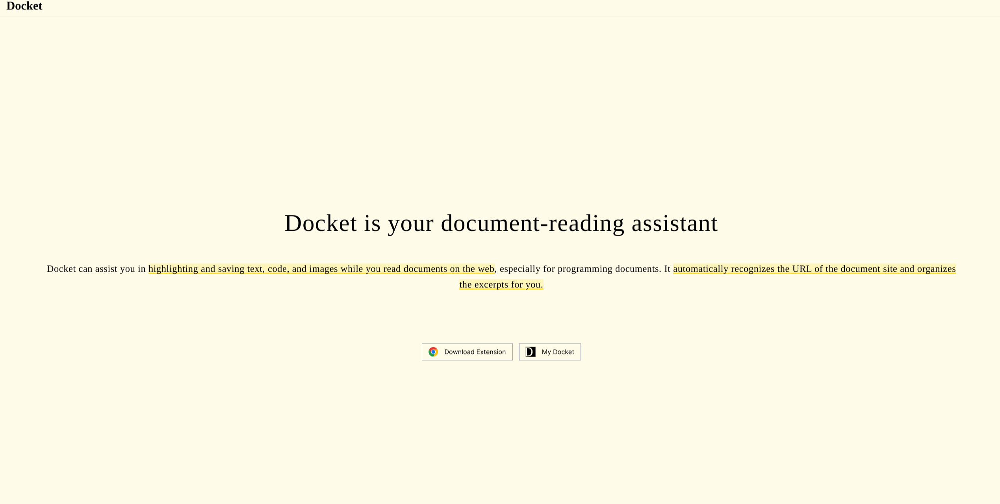
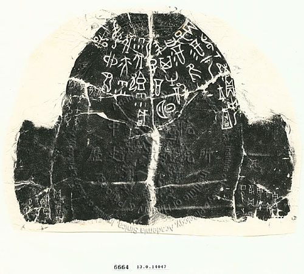

A few notes on what I did during this Spring Festival holiday.

## An Online Course

I finished the [animations.dev](https://animations.dev) course over the holiday. I had bought it before the break; it was the second online course I had paid for, after [Just Javascript](https://justjavascript.com/). I learned a great deal. I had been interested in web animation for a while, but my understanding was never very clear, and I only used `gsap` occasionally. This time I finally gained a more complete picture. The next step is to practice in real projects. At least I have made a start.

## UI Updates

I updated the UI for both Crane and [Docket](https://docket.space). The inspiration came from the neobrutalist designs I had seen earlier: brighter colors and more expressive typography. I feel that my design skills have improved. Other changes included upgrading my personal site to `eleventy v3.0` and moving Docket's deployment to Dokploy.


<image-compare @name="range-enabled" @value="50">
	
	
</image-compare>


## Reading

I finished two books: Xu Hong's *The Earliest Empire: The Shock Waves of Erligang Civilization* and *The Last Days of the Incas*. This holiday I became especially absorbed in Shimao, Erlitou, Erligang, and Yinxu, and the still mysterious history of the Xia and Shang. Despite extensive archaeological discoveries, this period remains shrouded in uncertainty. Each city has its own character; even the relationship between the names Yin and Shang is a puzzle. The reach of Erligang civilization was remarkably broad, suggesting a powerful Shang state at the time. Yet Yinxu looks very different, with oracle-bone writing and chariots marking major changes. Both are associated with Shang, but the archaeological record can make them seem like two different regimes. *The Last Days of the Incas* is an exceptionally painful book to read: 168 Spaniards conquered and destroyed a brilliant civilization. Countless Indigenous people died, great temples were burned, and revered rulers met violent deaths. The tragedy is almost unbearable to read.

## Watching

I watched two series, *One Hundred Years of Solitude* and *Light Shop*. I highly recommend both.

## Languages

I read part of the Haskell [guide](https://learnyouahaskell.github.io/chapters.html). Getting started was difficult. That is as far as I got.
