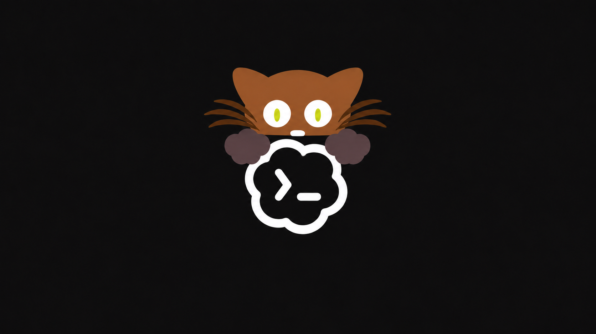
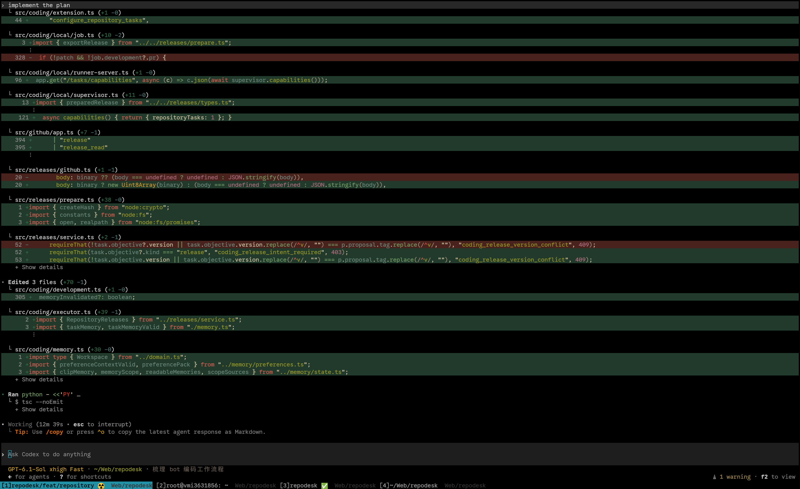
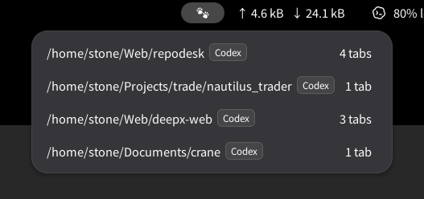

In my [2024 review](/posts/my-2024-review/en/), I mentioned switching my editor to `nvim` and my terminal to `kitty`. As I use Codex more often, my terminals now contain several agent sessions alongside the editor and development services. The number of windows and tabs has grown with them.

This post records the configuration I currently use.

## One Window per Project

I usually keep each project in its own Kitty window. Inside that window, I open a few tabs: one for Codex, one for the editor, and perhaps another for a development server. Everything for a project stays together, so switching windows means switching projects.

One small but useful setting makes new tabs start in the current directory. That saves me from running `cd` every time I open one.

These lines come from my current `~/.config/kitty/kitty.conf`:

```text
# Open a new tab in the current terminal working directory
map ctrl+shift+t launch --type=tab --cwd=current

# Open a terminal split in the current tab, inheriting the directory
map ctrl+shift+enter launch --cwd=current

# Open a separate OS window
map ctrl+shift+k new_os_window
```

`--cwd=current` follows the working directory of the current terminal. If you have moved into a project subdirectory, the new tab starts there too. The [Kitty FAQ](https://sw.kovidgoyal.net/kitty/faq/#how-do-i-open-a-new-window-or-tab-with-the-same-working-directory-as-the-current-window) explains the setting.

## Keeping the Project Directory in the Title

Here is my current tab bar configuration:

```text
tab_bar_style separator
tab_bar_min_tabs 1
tab_separator " "
tab_title_max_length 120
tab_title_template "[{index}]{fmt.fg.red}{bell_symbol}{fmt.fg.tab}{title}  {fmt.fg.color8}{'/'.join(tab.active_wd.split('/')[-2:])}"
inactive_tab_font_style normal
active_tab_font_style bold
bell_on_tab no

shell_integration no-cursor
```

The title retains the tab number, program title, and the last two parts of the directory path. For this blog project, for example, it shows `Documents/crane`. Even when the program title changes, the project directory remains visible. `tab_bar_min_tabs 1` keeps the tab bar visible even when there is only one tab.

`shell_integration no-cursor` keeps Kitty's shell integration enabled while preventing it from changing the cursor style. I configure the terminal cursor separately in Kitty.

## Showing Agent Status with Codex Hooks

When several agents are running, I mainly want to know which is still working, which has finished, and which needs my attention. Opening every tab to check is inconvenient.

This part was inspired by flurdy's [Useful Kitty tab titles for Claude Code, Codex and Pi](https://flurdy.com/docs/kitty-ai-tabs/). The idea is to let Codex lifecycle events trigger a script, then use Kitty remote control to update the corresponding tab title.

My current `kitty.conf` enables remote control with:

```text
allow_remote_control yes
listen_on unix:/tmp/kitty
```

This is the configuration on my machine. If you only use the title script and the top-bar extension below through a Unix socket, you can narrow the first line to `allow_remote_control socket-only`. Restart Kitty after changing `listen_on`; reloading the configuration alone is not enough. See the [Kitty configuration documentation](https://sw.kovidgoyal.net/kitty/conf/#opt-kitty.allow_remote_control) for these options.

Kitty appends a process ID to the socket address, making the actual address something like `unix:/tmp/kitty-12345`. The script needs to find an active socket and determine which tab to update.

### The Title Script

The script I currently use is `~/.local/bin/kitty-agent-title`. It is written in Python and only depends on the standard library, plus `git` and `kitten` on the system. The full code is available here: [kitty-agent-title.py](/downloads/kitty-agent-title.py). After downloading it, install it in the following location:

```bash
mkdir -p ~/.local/bin
cp ~/Downloads/kitty-agent-title.py ~/.local/bin/kitty-agent-title
chmod +x ~/.local/bin/kitty-agent-title
```

The script reads the JSON sent by Codex from standard input and extracts the event name, project directory, and session ID. The title contains the repository name and a shortened branch name; the branch is omitted on the main branch. These status symbols come from the current script:

```python
MARKS = {
    "SessionStart": "📢",
    "SessionEnd": "📢",
    "UserPromptSubmit": "⚒️",
    "PreToolUse": "☢️",
    "PostToolUse": "⚒️",
    "PermissionRequest": "🔔",
    "Stop": "✅",
    "SubagentStop": "✅",
    "SubagentStart": "👥",
    "PreCompact": "🧶",
    "PostCompact": "🧶",
    "Interrupt": "⛔",
}
```

The script already supports `SessionEnd` and `Interrupt`, but my current title hooks do not bind those events. The events I actually enable are:

| Codex event | Title symbol | Meaning |
| --- | --- | --- |
| `SessionStart` | 📢 | A session starts or resumes |
| `UserPromptSubmit`, `PostToolUse` | ⚒️ | A task was submitted, or a tool call finished |
| `PreToolUse` | ☢️ | A tool call is about to begin |
| `PermissionRequest` | 🔔 | Permission needs confirmation |
| `Stop` | ✅ | The current response has finished |
| `SubagentStart`, `SubagentStop` | 👥 / ✅ | A subagent started or finished |
| `PreCompact`, `PostCompact` | 🧶 | Context compaction started or just finished |

For example, while Codex runs in this blog directory, the tab title changes between `crane ⚒️`, `crane ☢️`, and `crane ✅`. The `Documents/crane` directory from the tab template follows it.



This is what it looks like in practice. The first tab at the bottom is calling a tool; another already shows `✅`. I can see that without switching tabs.

The symbols show the most recent event. A subagent's `✅`, for example, only means that subtask has finished; the overall task may still be running. After compaction, `🧶` stays until another event replaces it.

A substantial part of the script handles identifying the correct tab. If hooks run through a shared app-server, the inherited Kitty environment variables may belong to the terminal that originally started the daemon. Several tabs can also share a directory, so the directory alone is not enough.

The script therefore enumerates available Kitty sockets, reads `kitten @ ls`, and uses the session's thread name, terminal title, and directory to locate the right window. It only trusts the inherited `KITTY_WINDOW_ID` when it can confirm that the hook is running directly in the current terminal. If directory matching produces several equally good candidates, it skips the update. If thread-name matching still leaves a tie, it chooses the most recently focused candidate.

The key part that updates the title is below. In the full script, `target` is the terminal found by the matching process:

```python
code, _, err = run(
    [
        KITTEN,
        "@",
        "--to",
        target["address"],
        "set-tab-title",
        "--match",
        f"window_id:{target['window']}",
        title,
    ]
)
```

This lets a background session update its own title even while I am looking at another tab. If the script cannot identify the owner, it skips the update. Errors do not interrupt the agent.

### Binding Codex Hooks

Bind the events in `~/.codex/hooks.json`. The configuration below includes the title hooks actually enabled on my machine, with the script path changed to `$HOME` so it is easier to use elsewhere. You can also download [this hooks configuration](/downloads/kitty-codex-hooks.json).

```json
{
  "hooks": {
    "SessionStart": [{
      "matcher": "*",
      "hooks": [{ "type": "command", "command": "\"$HOME/.local/bin/kitty-agent-title\" codex", "timeout": 5 }]
    }],
    "UserPromptSubmit": [{
      "hooks": [{ "type": "command", "command": "\"$HOME/.local/bin/kitty-agent-title\" codex", "timeout": 5 }]
    }],
    "PreToolUse": [{
      "matcher": "*",
      "hooks": [{ "type": "command", "command": "\"$HOME/.local/bin/kitty-agent-title\" codex", "timeout": 5 }]
    }],
    "PostToolUse": [{
      "matcher": "*",
      "hooks": [{ "type": "command", "command": "\"$HOME/.local/bin/kitty-agent-title\" codex", "timeout": 5 }]
    }],
    "PermissionRequest": [{
      "matcher": "*",
      "hooks": [{ "type": "command", "command": "\"$HOME/.local/bin/kitty-agent-title\" codex", "timeout": 5 }]
    }],
    "Stop": [{
      "hooks": [{ "type": "command", "command": "\"$HOME/.local/bin/kitty-agent-title\" codex", "timeout": 5 }]
    }],
    "PreCompact": [{
      "matcher": "*",
      "hooks": [{ "type": "command", "command": "\"$HOME/.local/bin/kitty-agent-title\" codex", "timeout": 5 }]
    }],
    "PostCompact": [{
      "matcher": "*",
      "hooks": [{ "type": "command", "command": "\"$HOME/.local/bin/kitty-agent-title\" codex", "timeout": 5 }]
    }],
    "SubagentStart": [{
      "matcher": "*",
      "hooks": [{ "type": "command", "command": "\"$HOME/.local/bin/kitty-agent-title\" codex", "timeout": 5 }]
    }],
    "SubagentStop": [{
      "matcher": "*",
      "hooks": [{ "type": "command", "command": "\"$HOME/.local/bin/kitty-agent-title\" codex", "timeout": 5 }]
    }]
  }
}
```

If you already have hooks configured, merge these events into the existing configuration. A single event can have multiple handlers. My own `SessionStart`, for example, also has a hook that records the thread ID for the window-restoring extension.

After saving, restart Codex and run `/hooks` to inspect and trust the new configuration. Hooks receive JSON containing fields such as `hook_event_name`, `cwd`, and `session_id`. See the [Codex hooks documentation](https://learn.chatgpt.com/docs/hooks) for the exact format.

The script also includes a troubleshooting mode that shows the matching result without changing any titles:

```bash
printf '%s\n' '{"hook_event_name":"Stop","cwd":"/path/to/project"}' \
  | ~/.local/bin/kitty-agent-title codex --dry-run --json
```

Replace the example path with an actual project directory. The output includes candidate windows, the reasons they matched, and the proposed title. When several sessions share a directory, you can also provide the actual `session_id` so the script can look up the corresponding thread name. The default log is `/tmp/kitty-agent-title.log`.

### Restoring the Normal Title After Exit

There is one more small detail: when the agent exits, clear the fixed tab title so `✅` does not remain there indefinitely. I currently handle this in `precmd` in `~/.zshrc`. Here is the part that clears the Kitty title:

```zsh
precmd() {
  if [[ -n "$KITTY_WINDOW_ID" ]] && (( $+commands[kitten] )); then
    kitten @ set-tab-title "" >/dev/null 2>&1 \
      || { [[ -n "$KITTY_LISTEN_ON" ]] \
        && kitten @ --to "$KITTY_LISTEN_ON" set-tab-title "" \
          >/dev/null 2>&1; } \
      || true
  fi
}
```

`precmd` runs when the shell is about to display its next prompt. Clearing the explicitly assigned title lets Kitty follow the terminal's normal title again, while the tab template continues to show the directory. If you already have a `precmd`, add this logic to it.

## Kitty Status in the Top Bar

As the number of windows grows, I also use the GNOME top bar to inspect and switch between Kitty windows. The little paw in the screenshot is the entry point:



The extension installed on my machine is named **Kitty Session Restorer**, and its project is [kitty-paw](https://github.com/stonega/kitty-paw). Each menu row represents a Kitty OS window and shows the active terminal's directory, whether Codex is present in that window, and the total number of tabs. Clicking a row switches to it.

The `Codex` indicator comes from foreground-process detection. The actual working state is still shown in the tab titles configured earlier. Combined with the habit of keeping one project per window, the menu becomes a simple project list.

The extension also saves the positions of windows, tabs, splits, and workspaces. Once all Kitty windows are closed, you can restore them through `Restore` in the menu. The version currently installed supports GNOME Shell 50 and depends on Kitty's Unix socket. The earlier `listen_on unix:/tmp/kitty` setting matches its default socket template.

The editor, development services, and agents all stay in the project window. When something needs my attention, the title gives me a signal.
