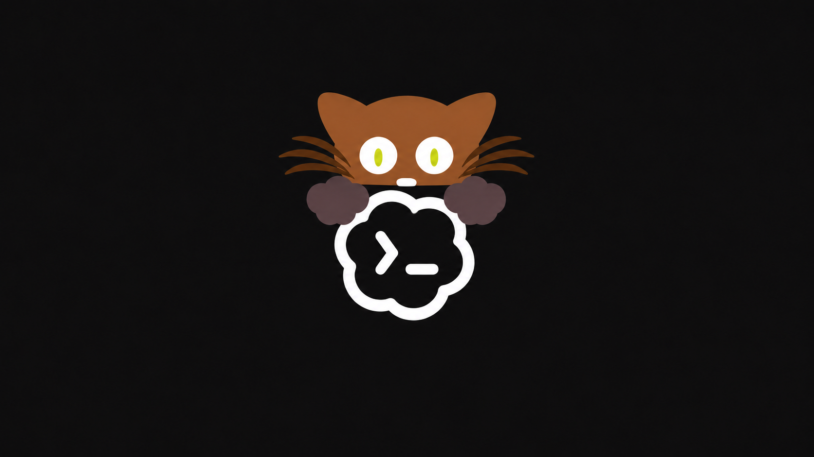
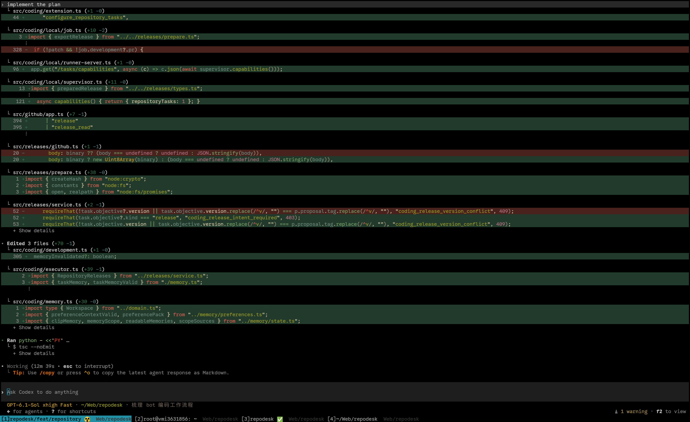
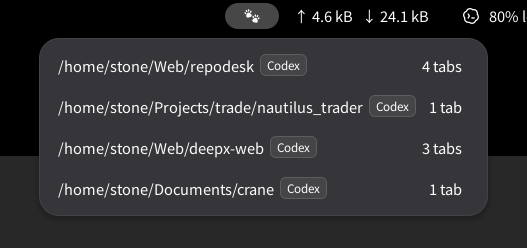

在 [2024 年度回顾](/posts/my-2024-review/) 里提到，编辑器切换到了 `nvim`，终端使用 `kitty`。现在 Codex 用得越来越多，终端里除了编辑器和开发服务，又多了几个 agent session，窗口和 tab 也跟着多了起来。

这篇记录一下目前系统里在用的配置。

## 一个项目一个窗口

目前习惯把一个项目放在一个 Kitty 窗口里。窗口里面再开几个 tab，一个跑 Codex，一个开编辑器，或者运行 develop 服务。同一个项目的东西放在一起，切换窗口也就是切换项目。

这里有一个很小但很有用的配置：在当前窗口里新建 tab 时，默认进入当前目录。这样就不用每次开完再 `cd` 一遍。

下面几行来自目前的 `~/.config/kitty/kitty.conf`：

```text
# 新建 tab，继承当前终端的工作目录
map ctrl+shift+t launch --type=tab --cwd=current

# 在当前 tab 里新建一个终端分屏，同样继承目录
map ctrl+shift+enter launch --cwd=current

# 新建一个独立的系统窗口
map ctrl+shift+k new_os_window
```

`--cwd=current` 跟随的是当前终端的工作目录。如果已经进入项目的子目录，新 tab 也会从那个子目录开始。[Kitty 的 FAQ](https://sw.kovidgoyal.net/kitty/faq/#how-do-i-open-a-new-window-or-tab-with-the-same-working-directory-as-the-current-window) 里有对应的配置说明。

## 让标题里有项目目录

目前的 tab bar 配置如下：

```text
tab_bar_style separator
tab_bar_min_tabs 1
tab_separator " "
tab_title_max_length 120
tab_title_template "[{index}]{fmt.fg.red}{bell_symbol}{fmt.fg.tab}{title}  {fmt.fg.color8}{'/'.join(tab.active_wd.split('/')[-2:])}"
inactive_tab_font_style normal
active_tab_font_style bold
bell_on_tab no

shell_integration no-cursor
```

标题里保留了 tab 序号、程序标题和目录的最后两级。比如当前这个博客项目，后面会显示 `Documents/crane`。即使前面的程序标题变了，项目目录依然能看到。`tab_bar_min_tabs 1` 则让只有一个 tab 的时候也显示标题栏。

`shell_integration no-cursor` 保留了 Kitty 的 shell integration，只关闭它对光标样式的调整。终端里的光标样式另外在 Kitty 配置里设置。

## 用 Codex hooks 显示 agent 状态

几个 agent 同时开着的时候，我更关心的是哪个还在工作，哪个已经结束，哪个需要我处理。总是逐个点进去看，还是有点麻烦。

这部分借鉴了 flurdy 的 [Useful Kitty tab titles for Claude Code, Codex and Pi](https://flurdy.com/docs/kitty-ai-tabs/)。思路是让 Codex 的生命周期事件触发一个脚本，再通过 Kitty remote control 更新对应 tab 的标题。

目前 `kitty.conf` 里开启 remote control 的配置是：

```text
allow_remote_control yes
listen_on unix:/tmp/kitty
```

这是我本机的实际配置。只通过 Unix socket 使用这套标题脚本和下文的顶栏扩展时，也可以把第一行收紧为 `allow_remote_control socket-only`。修改 `listen_on` 后需要重启 Kitty，单纯重载配置不会生效。相关选项见 [Kitty 配置文档](https://sw.kovidgoyal.net/kitty/conf/#opt-kitty.allow_remote_control)。

Kitty 会在 socket 地址后追加进程 ID，所以实际地址类似 `unix:/tmp/kitty-12345`。脚本需要找到当前仍然可用的 socket，再确定该更新哪个 tab。

### 标题脚本

目前使用的文件是 `~/.local/bin/kitty-agent-title`，用 Python 写的，只依赖标准库，以及系统里的 `git` 和 `kitten`。完整代码放在这里：[kitty-agent-title.py](/downloads/kitty-agent-title.py)。下载后安装到对应位置：

```bash
mkdir -p ~/.local/bin
cp ~/Downloads/kitty-agent-title.py ~/.local/bin/kitty-agent-title
chmod +x ~/.local/bin/kitty-agent-title
```

脚本从标准输入读取 Codex 传来的 JSON，取出事件名称、项目目录和 session ID。标题使用仓库名，加上缩短后的分支名；在主分支时就省略分支。状态对应的符号是这些，下面摘自当前脚本：

```python
MARKS = {
    "SessionStart": "📢",
    "SessionEnd": "📢",
    "UserPromptSubmit": "⚒️",
    "PreToolUse": "☢️",
    "PostToolUse": "⚒️",
    "PermissionRequest": "🔔",
    "Stop": "✅",
    "SubagentStop": "✅",
    "SubagentStart": "👥",
    "PreCompact": "🧶",
    "PostCompact": "🧶",
    "Interrupt": "⛔",
}
```

其中 `SessionEnd` 和 `Interrupt` 是脚本已经支持的事件，目前本机的标题 hooks 没有绑定它们。实际启用的状态如下：

| Codex 事件 | 标题符号 | 含义 |
| --- | --- | --- |
| `SessionStart` | 📢 | 开始或恢复 session |
| `UserPromptSubmit`、`PostToolUse` | ⚒️ | 提交了任务，或工具调用结束 |
| `PreToolUse` | ☢️ | 准备调用工具 |
| `PermissionRequest` | 🔔 | 需要确认权限 |
| `Stop` | ✅ | 本轮回复结束 |
| `SubagentStart`、`SubagentStop` | 👥 / ✅ | 子 agent 开始或结束 |
| `PreCompact`、`PostCompact` | 🧶 | 开始或刚完成上下文压缩 |

比如在这个博客目录里跑 Codex，tab 的标题就会随着事件在 `crane ⚒️`、`crane ☢️`、`crane ✅` 之间变化。后面还跟着前面配置的 `Documents/crane`。



这是实际使用时的样子。底部第一个 tab 正在调用工具，另一个 tab 已经显示了 `✅`，不用切进去也能看见。

这些符号表示最近发生的事件。比如子 agent 的 `✅` 表示那个子任务结束，整个任务可能还在继续；压缩完成后，也要等下一个事件才会换掉 `🧶`。

当前脚本里花了比较多代码处理 tab 的归属。hooks 如果由共享的 app-server 执行，继承到的 Kitty 环境变量可能来自启动 daemon 时的终端。多个 tab 又可能在同一个目录，单靠目录也分不清。

所以脚本会枚举可用的 Kitty socket，读取 `kitten @ ls`，结合 session 的 thread name、终端标题和目录寻找对应窗口。能确认 hooks 直接运行在当前终端里时，才使用继承的 `KITTY_WINDOW_ID`。只按目录找到多个同分候选时会跳过更新；thread name 仍有同分时，则按最近聚焦时间选择。

最后更新标题的关键代码是这一段，完整脚本中的 `target` 就是前面查找到的终端：

```python
code, _, err = run(
    [
        KITTEN,
        "@",
        "--to",
        target["address"],
        "set-tab-title",
        "--match",
        f"window_id:{target['window']}",
        title,
    ]
)
```

这样即使我正在看另一个 tab，后台 session 的事件也能更新它自己的标题。找不到归属时，脚本会跳过，错误也不会中断 agent。

### 绑定 Codex hooks

在 `~/.codex/hooks.json` 里绑定事件。下面保留了本机实际启用的标题 hooks，把脚本路径换成了 `$HOME`，方便在其他机器上使用。也可以直接下载 [这份 hooks 配置](/downloads/kitty-codex-hooks.json)。

```json
{
  "hooks": {
    "SessionStart": [{
      "matcher": "*",
      "hooks": [{ "type": "command", "command": "\"$HOME/.local/bin/kitty-agent-title\" codex", "timeout": 5 }]
    }],
    "UserPromptSubmit": [{
      "hooks": [{ "type": "command", "command": "\"$HOME/.local/bin/kitty-agent-title\" codex", "timeout": 5 }]
    }],
    "PreToolUse": [{
      "matcher": "*",
      "hooks": [{ "type": "command", "command": "\"$HOME/.local/bin/kitty-agent-title\" codex", "timeout": 5 }]
    }],
    "PostToolUse": [{
      "matcher": "*",
      "hooks": [{ "type": "command", "command": "\"$HOME/.local/bin/kitty-agent-title\" codex", "timeout": 5 }]
    }],
    "PermissionRequest": [{
      "matcher": "*",
      "hooks": [{ "type": "command", "command": "\"$HOME/.local/bin/kitty-agent-title\" codex", "timeout": 5 }]
    }],
    "Stop": [{
      "hooks": [{ "type": "command", "command": "\"$HOME/.local/bin/kitty-agent-title\" codex", "timeout": 5 }]
    }],
    "PreCompact": [{
      "matcher": "*",
      "hooks": [{ "type": "command", "command": "\"$HOME/.local/bin/kitty-agent-title\" codex", "timeout": 5 }]
    }],
    "PostCompact": [{
      "matcher": "*",
      "hooks": [{ "type": "command", "command": "\"$HOME/.local/bin/kitty-agent-title\" codex", "timeout": 5 }]
    }],
    "SubagentStart": [{
      "matcher": "*",
      "hooks": [{ "type": "command", "command": "\"$HOME/.local/bin/kitty-agent-title\" codex", "timeout": 5 }]
    }],
    "SubagentStop": [{
      "matcher": "*",
      "hooks": [{ "type": "command", "command": "\"$HOME/.local/bin/kitty-agent-title\" codex", "timeout": 5 }]
    }]
  }
}
```

如果已经配置了其他 hooks，把这些事件合并进去即可。同一个事件也可以有多个 handler，我本机的 `SessionStart` 里就还有给窗口恢复扩展记录 thread ID 的 hook。

保存后重新启动 Codex，运行 `/hooks` 检查并信任新配置。hooks 会收到包含 `hook_event_name`、`cwd`、`session_id` 等字段的 JSON，具体格式可以查 [Codex hooks 文档](https://learn.chatgpt.com/docs/hooks)。

脚本还留了一个排查用的入口，可以只查看匹配结果，不实际修改标题：

```bash
printf '%s\n' '{"hook_event_name":"Stop","cwd":"/path/to/project"}' \
  | ~/.local/bin/kitty-agent-title codex --dry-run --json
```

换成实际项目路径后，输出会包含候选窗口、匹配原因和准备设置的标题。同一目录开了多个 session 时，可以再传入实际的 `session_id`，让脚本查找对应的 thread name。默认日志在 `/tmp/kitty-agent-title.log`。

### 退出后恢复普通标题

还有一个小细节：agent 退出后，要把固定的 tab 标题清掉，否则 `✅` 会一直留在那里。目前是在 `~/.zshrc` 的 `precmd` 里处理，下面是其中清理 Kitty 标题的部分：

```zsh
precmd() {
  if [[ -n "$KITTY_WINDOW_ID" ]] && (( $+commands[kitten] )); then
    kitten @ set-tab-title "" >/dev/null 2>&1 \
      || { [[ -n "$KITTY_LISTEN_ON" ]] \
        && kitten @ --to "$KITTY_LISTEN_ON" set-tab-title "" \
          >/dev/null 2>&1; } \
      || true
  fi
}
```

`precmd` 在 shell 准备显示下一次提示符时运行。清空显式设置的 tab 标题后，Kitty 会重新跟随当前终端的普通标题，目录仍然由 tab 模板显示。如果已经有 `precmd`，把这段逻辑放进去即可。

## 顶栏里的 Kitty Status

窗口多了之后，我还会从 GNOME 顶栏查看和切换 Kitty 窗口。截图里的小爪子就是这个入口：



本机安装的扩展名是 **Kitty Session Restorer**，项目在 [kitty-paw](https://github.com/stonega/kitty-paw)。菜单每一行对应一个 Kitty 系统窗口，显示当前活动终端的目录、这个窗口里有没有 Codex，以及一共开了几个 tab。点一下就可以切换过去。

这个 `Codex` 标记来自前台进程检测，具体的工作状态还是看前面配置的 tab 标题。配合一个项目一个窗口的习惯，这个菜单也就成了一个简单的项目列表。

扩展还会保存窗口、tab、分屏和工作区的位置。在所有 Kitty 窗口关闭后，可以从菜单里的 `Restore` 恢复。当前安装版本适用于 GNOME Shell 50，依赖 Kitty 的 Unix socket；前面的 `listen_on unix:/tmp/kitty` 正好对应它默认的 socket 模板。

编辑器、开发服务和 agent 都留在项目窗口里，需要介入的时候，标题会给一个提示。
