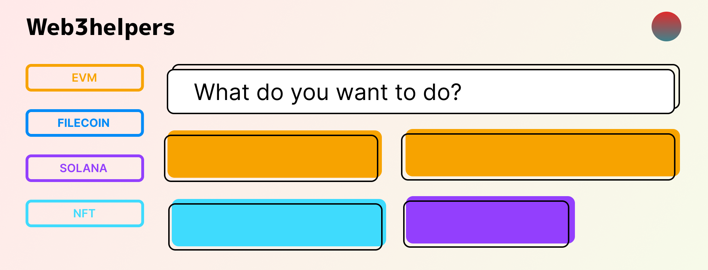
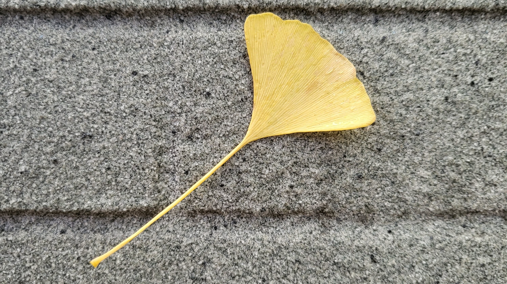

# Looking Back at 2022

It is already March 4, 2023. This spring has been especially cold, and on this chilly night I have finally remembered to write last year's review. Lately I have started using Notion to record what I finish each day. By the time I leave work in the evening, I can barely remember the details of the day. There are so many small, scattered tasks that the details slip away, which worries me a little. Since I cannot remember them, I went back through the 2022 activity on my GitHub profile, from December to January, to piece together what kept me busy.

## Personal Projects

In 2022 I began experimenting with building my own projects using Next.js and designing them in Figma. None really took off, but I learned a lot about the product manager's role and gained useful experience. The initial design of a product's features matters enormously; otherwise, it is easy to finish something with fundamental shortcomings.

**Lens.ink**

[lens.ink](https://lens.ink)

Lens.ink was a web app built on Lens Protocol. I wanted to create an app directory for Lens users, somewhere they could quickly access apps across the ecosystem. The result was disappointing. The initial requirements were not quite right: this was not a particularly compelling need, and the finished project was not good enough either.

This was my first Next.js project. I used Next.js for my subsequent personal projects, while continuing to use Nuxt.js at work. It was also my first time working with a GraphQL API, and I became more comfortable with Tailwind CSS.

**Web3Helpers**

[Web3Helpers](https://web3helpers.xyz)

Web3Helpers is a collection of web3 tools. The aim was to give small development tasks a UI: quickly creating an ERC20 token, decoding an Ethereum `rawTransaction`, or making JSON-RPC requests. While building it, I explored other chains such as Solana, Aptos, and Sui and gained a basic understanding of them. I also developed [Wallet Hooks](https://github.com/web3helpers/wallets-hooks) to meet the project's needs, which deepened my understanding of React hooks. Each small tool was a relatively independent app, so I built a reusable UI component library and a CLI to support them.

Looking back, web3helpers still seems like a worthwhile project to continue in 2023. It may need more complex tools. Even adding a simple swap tool could be a good idea.

## Work

The most important change at work in 2022 was adopting TypeScript throughout our projects. It went from feeling awkward to becoming indispensable. TypeScript greatly improved the JavaScript development experience and reduced bugs. For example, I wrote a CLI that turns backend API definition files into a corresponding Axios request library, with TypeScript support by default. When using these APIs, I no longer need to type response field names from memory because the IDE suggests them. Previously, I had to inspect a response in the browser and copy its fields into the code. That made it easy to miss backend field changes or leave a typo unnoticed.

I also created the `website-template` and `dapp-template` projects. The former helps us build company websites quickly, and I built quite a few that year; the latter helps us start dapps. The templates standardize the packages used within the team and include common components.

During the National Day holiday, I started `abmatrix-ui` to gather components we frequently use at work and make them easier to reuse. Unfortunately, it did not receive much maintenance or use afterward.

The last few months of the year were spent developing the SBTAuth SDK. It was a substantial challenge. I learned a great deal, especially about messaging APIs in the browser, and kept reconsidering the project's architecture and implementation.

An important task for 2023 is upgrading to `NuxtJs3.0` and the corresponding `Vue3.0`.

## Life

After countless rounds of PCR tests, the pandemic restrictions finally ended in 2022. We no longer had to open health-code apps. I am grateful that my family and friends all made it through safely.

Life did not seem to change very much. I started learning latte art at a café, improving a little every day and falling more and more in love with coffee.

I did not travel this year. In the second half of the year I read quite a few books about the Wei, Jin, and Northern and Southern dynasties, finally catching up with an interest that had become popular some time earlier. It really was an absurd and fascinating era. The book I would most recommend is Luo Xin's *[The Long Remainder of Life](https://book.douban.com/subject/35909188/)*.

On the very last day of 2022, I met a girl I really liked. That was my greatest stroke of luck. I hope everything goes well in 2023.
