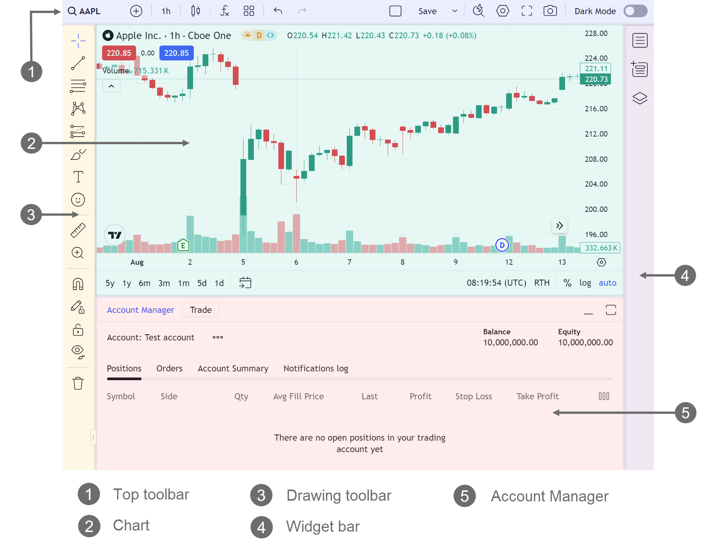
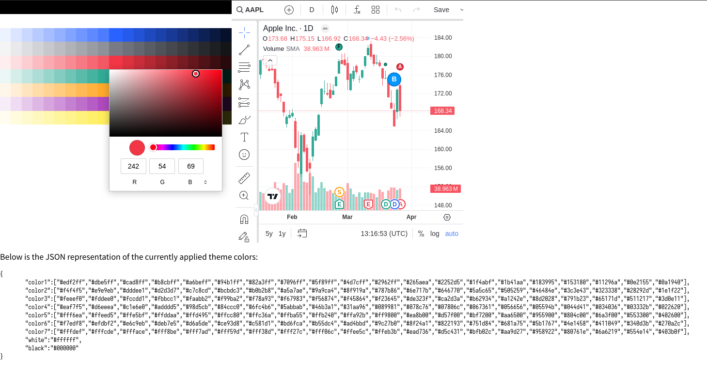

This post covers integrating TradingView Advanced Charts into a web project.

## Applying for Access

TradingView Advanced Charts is free to use, but you need to request access to the library through the [official website](https://www.tradingview.com/advanced-charts/). Use a company email address when applying. In my experience, a reply arrived within a week. Follow the instructions in the email, complete and sign the agreement, and send it back. Make sure the email address in the agreement matches the one used for the application.

## Usage

Setting up the TradingView widget involves three steps:

1. [Download the library](https://github.com/tradingview/charting_library/tree/master/charting_library) from the project repository and place it in your project's public directory, usually `public`.
2. Add `<div id="tv_chart_container"></div>` to the DOM.
3. Initialize `tvWidget`.

```javascript
window.tvWidget = new TradingView.widget({
    library_path: "path_to_charting_library",
	locale: 'en',
	container: 'tv-chart-container',
	autosize: true,
	interval: '1', // 1 minute
	favorites: {
		intervals: ['1', '15', '1D'],
	},
	allow_symbol_change: false,
	theme: 'light',
    symbol: `EXCHANGE:BTC/USDT`, // default pair
    timezone: Intl.DateTimeFormat().resolvedOptions().timeZone,
	disabled_features: [...],
	enabled_features: [...],
	custom_themes: {
		light: [...],
		dark: [...]
	},
    datafeed: ...,
});
```

Set `autosize` to `true` to make the widget fill its parent container. You then only need to define the parent's dimensions.

Set `timezone` to `Intl.DateTimeFormat().resolvedOptions().timeZone` to display times in the user's time zone.

Use `disabled_features` and `enabled_features` to choose which features are available. For example, configure these when you need to hide parts of the UI. See the [featureset documentation](https://www.tradingview.com/charting-library-docs/latest/customization/Featuresets) for the available options. Here is my configuration:

```js
disabled_features: [
    'symbol_search_hot_key',
    'header_quick_search',
    'header_symbol_search',
    'header_compare',
    'header_settings',
    'header_undo_redo',
    'header_saveload',
    'items_favoriting',
    'symbol_search_hot_key',
    'symbol_info',
    'edit_buttons_in_legend',
    'delete_button_in_legend',
    'use_localstorage_for_settings',
    'create_volume_indicator_by_default',
    'popup_hints',
],
enabled_features: ['show_interval_dialog_on_key_press', 'items_favoriting'],
```

Use the following diagram to find the names of UI elements:



`custom_themes` defines the themes. Usually, you will configure both a `light` theme and a `dark` theme.

The theme includes nine colors: `color1`, `color2`, `color3`, `color4`, `color5`, `color6`, `color7`, `white`, and `black`. `color1` is the primary color, `color3` is red, and `color4` is green. You can configure a theme in [this editor](https://codepen.io/tradingview/pen/abgzyBW) and copy it into your project.



The remaining option, `datafeed`, is the most important part. It provides the following methods; see the [datafeed API documentation](https://www.tradingview.com/charting-library-docs/latest/connecting_data/datafeed-api/required-methods/#onready).

```ts
interface Datafeed {
	onReady(callback: OnReadyCallback) => void;
	searchSymbol(
      userInput: string,
      exchange: string,
      symbolType: string,
      onResult: SearchSymbolsCallback,
	) => Promise<void>;
    resolveSymbol(
      symbolName: string,
      onResolve: ResolveCallback,
      onError: DatafeedErrorCallback,
      extension?: SymbolResolveExtension,
    ) => Promise<void>;
    getBars(
      symbolInfo: LibrarySymbolInfo,
      resolution: ResolutionString,
      periodParams: PeriodParams,
      onResult: HistoryCallback,
      onError: DatafeedErrorCallback,
    ) => Promise<void>;
	subscribeBars(
      symbolInfo: LibrarySymbolInfo,
      resolution: ResolutionString,
      onTick: SubscribeBarsCallback,
      listenerGuid: string,
	  onResetCacheNeededCallback: () => void,
    ) => Promise<void>;
	unsubscribeBars(subscriberUID: string) => void
}
```

`onReady` runs when the chart initializes. Use its callback to provide the basic configuration.

`searchSymbol` searches for symbols based on the user's input.

`resolveSymbol` provides information about a symbol.

```js
const symbolInfo = {
    ticker: 'BTCUSD',
    name: 'BTCUSD',
    description: 'Bitcoin/USD',
    type: symbolItem.type,
    session: '24x7',
    timezone: 'Etc/UTC',
    exchange: 'Example Exchange',
    minmov: 1,
    pricescale: 100,
    has_intraday: false,
    visible_plots_set: 'ohlcv',
    has_weekly_and_monthly: false,
    supported_resolutions: ['1', '5', '30', '60', '1D', '1W'],
    volume_precision: 2,
    data_status: 'streaming',
};
```

`getBars` retrieves historical data.

`subscribeBars` delivers new data updates.

`unsubscribeBars` is called to remove a subscription when the chart changes symbols.
